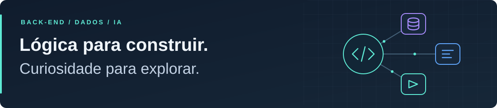
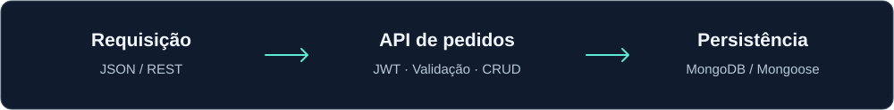

# Álvaro Marinho

<picture>
  <source media="(max-width: 600px)" srcset="assets/cover-pt-compact.svg">
  
</picture>

[English](README.en.md) · **Em busca de estágio em back-end**

Sou estudante de **Ciência da Computação na PUC Minas**, com formação técnica em **Desenvolvimento de Sistemas pelo COLTEC/UFMG**. Busco **estágio em desenvolvimento de software**, com foco em back-end e interesse em aprofundar meus conhecimentos em IA.

Minha experiência reúne desenvolvimento de APIs, programação orientada a objetos e um estágio em análise de dados, com Python, SQL e automação. Gosto de trabalhar com lógica, dados e regras de negócio — e de entender como uma solução funciona por trás da interface.

## 🚀 Projeto em destaque

### [API de pedidos — Node.js e MongoDB](https://github.com/Alvaromarinho75/jitterbit-API-challenge)

Projeto pessoal baseado em um desafio técnico de integração de sistemas. Recebe pedidos com campos em português, transforma os dados para um modelo em inglês e persiste no MongoDB.

<picture>
  <source media="(max-width: 600px)" srcset="assets/order-flow-pt-compact.svg">
  
</picture>

- **Back-end:** CRUD com Express e Mongoose, autenticação JWT, validação de entradas e tratamento de erros HTTP.
- **Dados:** índice único e tratamento de pedidos duplicados, incluindo criações concorrentes.
- **Verificação:** 26 testes automatizados, incluindo integração HTTP com um MongoDB real e temporário.
- **Documentação:** contrato OpenAPI, exemplos de requisições, instruções de execução e decisões técnicas em repositório com README em português e inglês.

[Explorar o código](https://github.com/Alvaromarinho75/jitterbit-API-challenge) · [Ver os testes](https://github.com/Alvaromarinho75/jitterbit-API-challenge/tree/main/tests) · [Ler as decisões técnicas](https://github.com/Alvaromarinho75/jitterbit-API-challenge/blob/main/docs/decisoes.md)

## 🧪 Outros projetos e estudos

### [Sistema de cinema em Java](https://github.com/Alvaromarinho75/TPFinal-POO)

Projeto acadêmico com modelagem de cinemas, salas, sessões e ingressos; orientação a objetos, exceções e serialização em arquivos.

### [Computação evolucionária em Processing](https://github.com/Alvaromarinho75/Processing/tree/main/computacaoEvolucionaria)

Simulação experimental com organismos, características herdadas, mutação e busca por recursos. Um estudo ligado ao meu interesse em algoritmos e IA.

## 🛠️ Tecnologias e fundamentos

**Back-end**

**Dados e automação**

Também trabalhei com **Excel e VBA/macros** em rotinas de dados.

**Base acadêmica e ferramentas**

APIs REST · JWT · OpenAPI/Swagger · Testes de integração · GitHub

**Quero aprofundar:** inteligência artificial, computação evolucionária e aplicações de IA em soluções de back-end.

## 💼 Experiência

**Estagiário em Análise de Dados · Cosimat**

Junho a dezembro de 2025 · Matozinhos, MG

- Desenvolvi scripts e automações para rotinas internas, utilizando Python, SQL e ferramentas de dados.
- Trabalhei com dashboards em Power BI e automações em Excel com VBA/macros.
- Apoiei a análise de logs, a depuração de código e a manutenção de rotinas de sistemas.

Também sou cofundador da [Digital S&D](https://github.com/Digital-S-D), uma iniciativa de desenvolvimento web com projetos realizados em equipe.

## 🎓 Formação e idiomas

- **Ciência da Computação — PUC Minas**, campus Coração Eucarístico · agosto de 2026–em andamento.
- **Técnico em Desenvolvimento de Sistemas — COLTEC/UFMG** · 2023–2025, concluído.
- **Idiomas:** português nativo e inglês avançado.

Estou em Minas Gerais, com disponibilidade para oportunidades presenciais ou híbridas em Belo Horizonte.
